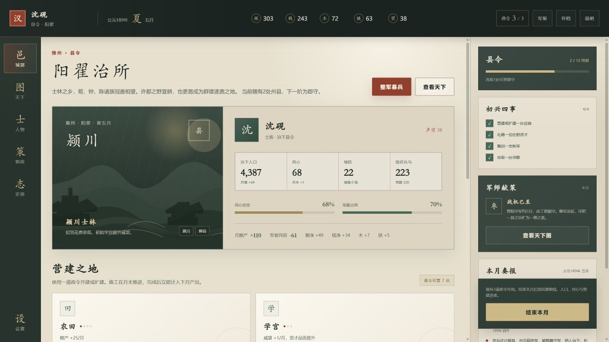

# Hanmo: Lord of Rivers and Mountains

### 汉末 · 山河领主

A single-player browser strategy and management game set in the late Eastern Han dynasty. Choose a starting region, develop your city, appoint historical figures, shape local policy, raise an army, and campaign across a stylized map of the realm.

一款以东汉末年为舞台的单机网页策略经营游戏。你可以择地起兵、建设城郭、招贤任能、施行政策、整军备战，并逐步经营自己的州郡。



## Features

- Twelve starting regions and multiple backgrounds and eras.
- City construction, resource management, population, public order, recruitment, and training.
- Historical officers, appointments, policies, events, and a turn-based court loop.
- Regional armies, tactical battles, and a campaign map.
- Automatic local saves in the browser, with no server account required.
- Vanilla HTML, CSS, and JavaScript with no runtime dependencies or downloaded art assets.

## Play Locally

On Windows, double-click `start-game.bat`. It starts a local server at `http://127.0.0.1:8765/` and opens the game in your default browser.

Alternatively, run any static-file server from this directory. For example:

```powershell
python -m http.server 8765 --bind 127.0.0.1
```

Then open `http://127.0.0.1:8765/`.

The game does not need a package manager or a production build.

## Project Structure

```text
index.html          Game shell and interface markup
styles.css          Layout, art direction, and responsive presentation
data.js             Historical regions, officers, policies, and game data
game.js             Simulation, interface state, and game flow
game-preview.png    README preview
start-game.bat      Windows local launcher
hanmo-archive/      Earlier standalone prototype kept for reference
```

## Contributing

Contributions are welcome through public issues and pull requests. Repository write access is intentionally limited to the project maintainer.

See [CONTRIBUTING.md](CONTRIBUTING.md) for details.

## License

This project is available under the [MIT License](LICENSE).
